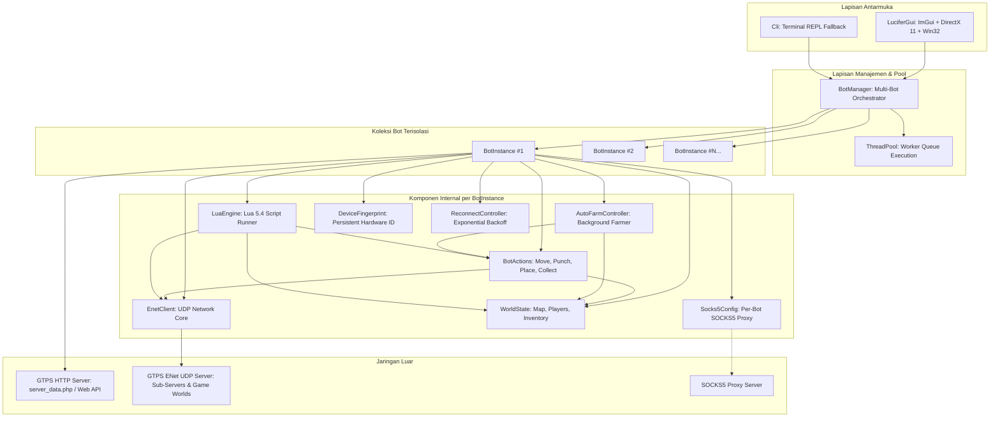

# 🏛️ Arsitektur Sistem — Lucifer GTPS Bot

Dokumen ini menjelaskan rancangan arsitektur perangkat lunak, pembagian modul, alur data (*data flow*), model multithreading, dan manajemen memori dalam **Lucifer GTPS Bot**.

---

## 1. Diagram Arsitektur Tingkat Tinggi



---

## 2. Alur Data (Data Flow)

Alur eksekusi aplikasi berjalan melalui tahapan terstruktur:

```text
[Aplikasi Start]
       │
       ▼
1. Baca Konfigurasi (.env atau config.json)
       │
       ▼
2. HTTP Login Phase
       ├── Mengirim HTTP POST / GET ke GTPS_LOGIN_URL
       ├── Parsing response: server_data.php pipe-delimited atau JSON
       └── Ekstraksi: server_ip, server_port, meta, token, loginurl
       │
       ▼
3. Inisialisasi Identitas Perangkat (Anti-Detection)
       ├── Load atau generate DeviceFingerprint (.fingerprints/<GrowID>.json)
       └── Format string handshake Growtopia (mac, rid, wk, fz, zf, hash, fhash, dll.)
       │
       ▼
4. Inisialisasi ENet Client
       ├── enet_host_create()
       ├── Aktifkan enet_host_compress_with_range_coder()
       └── Setup host->checksum = enet_crc32
       │
       ▼
5. Koneksi UDP & Handshake
       ├── Connect ke game_host:game_port
       ├── Terima NET_MESSAGE_SERVER_HELLO dari server
       └── Balas dengan NET_MESSAGE_GENERIC_TEXT (handshake identitas bot)
       │
       ▼
6. Proses Autentikasi & Masuk Game
       ├── Terima "Logon authenticated" / OnSuperMainStartAcceptLogon
       ├── Kirim action|enter_game
       ├── Terima PACKET_SEND_INVENTORY_STATE & PACKET_SEND_MAP_DATA
       └── Auto-warp ke TARGET_WORLD (jika disetel)
       │
       ▼
7. Main Loop (DirectX 11 GUI / CLI)
       ├── Polling ENet non-blocking (enet_host_service timeout 0)
       ├── Update ReconnectController jika terputus
       ├── Render ImGui tabs (Status, Multi-Bot, Movement, Inventory, Radar, Anti-Det, Lua)
       └── Dispatch Lua event hooks (OnDraw, OnVariant, OnProcessTankUpdate)
```

---

## 3. Pembagian Modul & Tanggung Jawab Kelas

### A. Lapisan Jaringan (`src/enet_client.*`, `src/http_client.*`, `src/socks5.*`)
- **`EnetClient`**:
  - Membungkus library `libenet` (C API) ke dalam antarmuka C++ modern.
  - Mengelola lifecycle `ENetHost` dan `ENetPeer`.
  - Mengirim paket dengan header 4-byte `[uint32 type] + [payload]`.
  - Polling non-blocking event (`ENET_EVENT_TYPE_CONNECT`, `DISCONNECT`, `RECEIVE`) dan dispatch callback ke luar mutex untuk mencegah *deadlock*.
- **`HttpClient`**:
  - Menggunakan `cpp-httplib` dan `WinHTTP` API bawaan Windows untuk menangani TLS/HTTPS dan self-signed SSL certificate bypass.
  - Menangani web login validation via Base64 token (`/player/growid/login/validate`).
- **`Socks5Client`**:
  - Implementasi murni protokol SOCKS5 (RFC 1928) & Username/Password Authentication (RFC 1929).
  - Melakukan TCP CONNECT handshake dan negosiasi UDP ASSOCIATE relay.

### B. Lapisan State Game (`src/world.*`, `src/game_packet.hpp`, `src/packet.hpp`)
- **`WorldState`**:
  - Menyimpan snapshot status world: ukuran map ($W \times H$), array tile (foreground, background, collision type, visual flag).
  - Melacak daftar pemain (`NetAvatar`) berdasarkan `net_id` dan `user_id`.
  - Melacak item yang jatuh di world (`WorldObject`) beserta koordinat pixel dan UID objek.
  - Melacak isi tas inventaris (`InventoryItem`) beserta item ID dan jumlah.
  - Thread-safe melalui `mutable std::mutex mtx_`.
- **`TankPacketHelper`**:
  - Serialisasi dan deserialisasi struktur biner 56-byte `GameUpdatePacket`.
  - **Aturan Validasi 61-Byte**: Memastikan paket state selalu memiliki trailing byte nol agar panjang paket total minimal 61 byte (`4 header + 56 struct + 1 trailing`), mencegah disconnect dari server GTPS modern.
  - Parser dan generator `VariantList` (data tipe string, float, integer, uint, vector).

### C. Lapisan Aksi & Otomasi (`src/bot_actions.*`, `src/lua_engine.*`)
- **`BotActions`**:
  - Menyediakan operasi tingkat tinggi: `moveTo(tx, ty)` (dengan interpolasi lintasan multi-step), `hit(tx, ty)`, `place(id, tx, ty)`, `wrench(tx, ty)`, `enter()`, `collectNearby(radius)`, `drop(id, count)`, `trash(id, count)`, `say(text)`, `warp(name)`, `respawn()`.
- **`AutoFarmController`**:
  - Menjalankan rutinitas penanaman/pembongkaran blok pada thread latar belakang terpisah.
  - Dilengkapi verifikasi ketersediaan stok inventaris dan auto-collect hasil drop.
- **`LuaEngine`**:
  - Mengintegrasikan Lua 5.4 ke dalam aplikasi C++.
  - Mendukung dua dialek sekaligus:
    1. **Bothax Lua Docs API**: `GetLocal()`, `GetWorld()`, `GetTiles()`, `GetPlayerList()`, `GetObjectList()`, `SendPacket()`, event hooks `OnVariant`, `OnSendPacket`, `OnProcessTankUpdate`, dll.
    2. **Lucifer Lua v2.86 API**: `bot:getLocal()`, `bot:getWorld()`, `bot:moveTo()`, `bot:hit()`, `bot:place()`, `bot:collect()`, `sleep()`, `log()`.

### D. Lapisan Anti-Deteksi & Reconnect (`src/anti_detection.*`, `src/reconnect_controller.*`)
- **`DeviceFingerprint`**:
  - Membuat identitas hardware realistis unik per akun.
  - Mengunci MAC, RID, WK, dan integer hash ke dalam file `.fingerprints/<GrowID>.json`.
- **`AntiDetection`**:
  - `sleepWithJitter(base_ms, jitter_ms)`: Memberikan deviasi acak $\pm15\text{--}25\%$ pada interval gerakan dan aksi bot.
  - `maybeHumanPause(chance, min_ms, max_ms)`: Simulasi jeda ragu manusia (micro-pause).
- **`ReconnectController`**:
  - Finite State Machine (`Connected`, `WaitingReconnect`, `Reconnecting`, `Disconnected`, `Disabled`).
  - Exponential backoff: $\text{delay} = \min(\text{max\_delay}, \text{initial} \times \text{multiplier}^n) \pm \text{jitter}$.
  - Otomatis reset counter ke 0 saat menerima `PACKET_SEND_MAP_DATA`.

### E. Lapisan Multi-Bot & Thread Pool (`src/bot_instance.*`, `src/bot_manager.*`, `src/thread_pool.*`)
- **`BotInstance`**:
  - Objek mandiri yang mengisolasi satu akun bot lengkap (ENet socket, World state, Actions, Lua, Fingerprint, Proxy).
- **`BotManager`**:
  - Mengelola kontainer `std::vector<std::shared_ptr<BotInstance>>`.
  - Fitur eksekusi massal: `startAll(stagger_ms)`, `stopAll()`, `warpAll()`, `sayAll()`, `loadAccountsFromFile()`, `saveAccountsToFile()`.
- **`ThreadPool`**:
  - Pool thread pekerja berkinerja tinggi dengan antrean tugas thread-safe (`std::condition_variable` & `std::queue`).

### F. Lapisan Antarmuka Grafis (`src/gui.*`)
- **`LuciferGui`**:
  - Inisialisasi Win32 Window dengan Dark Mode Immersive Theme (`DwmSetWindowAttribute`).
  - Inisialisasi Microsoft DirectX 11 Device, SwapChain, dan RenderTargetView.
  - Integrasi Dear ImGui dengan **Palet Deep Space Navy & Electric Cyan (Identik dengan Lucifer v2.85)**:
    - Background: Sangat gelap `#070d16`
    - Card Panels: Dark Navy `#0b1726` dengan Border `#143352`
    - Akses & Seleksi: Electric Cyan `#00a8ff` / `#0090e3`
    - Status Online: Neon Lime Green `#00ff88` / `#2ecc71`
  - **Widget Kustom Khas Lucifer**:
    - `ToggleSwitch(id, bool*)`: Sakelar toggle berbentuk pil lonjong modern dengan sliding circular knob putih.
    - D-Pad Cross Navigation: Layout salib simetris dengan tombol Enter Pintu/Portal (`🚪`) di pusat.
  - **Hierarki Navigasi Antarmuka Lucifer v2.85**:
    - **Title Bar**: Judul `Lucifer v2.85 [discord.gg/nuron]` dengan kontrol ikon `[+]`, `[🔒]`, `[🔄]`, `[⏻]`.
    - **Top Navigation Bar**:
      1. `[ 🤖 Bots ]`: Dashboard utama (Sidebar pemilih bot + Konten Sub-Tabs).
      2. `[ 📋 List ]`: Tampilan tabel multi-bot lengkap (ID, Akun, Status, World, Gems, Ping, Proxy, Aksi).
      3. `[ </> Executor ]`: Editor skrip Lua 5.4 multi-baris dan executor.
      4. `[ 🌐 Proxy ]`: Pengelola & live tester koneksi proxy SOCKS5 (RFC 1928/1929).
      5. `[ 🔀 Switch ]`: Peralihan cepat sub-server dan kontrol fast-reconnect.
      6. `[ 🗄️ Database ]`: Cache database item Growtopia (`items.dat`) dengan filter pencarian instan.
      7. `[ ⚙️ Settings ]`: Konfigurasi server host, port, login URL, versi game, dan protokol.
    - **Panel Kiri `[ 🤖 Bots ]` (Sidebar Bot Selector)**:
      - Toggle `Select All` + Checkbox `Enable Multi-Select`.
      - Box daftar bot dengan status online berwarna hijau neon (`#00ff88`).
      - Input pencarian: `Search for bots..`
      - Tombol aksi: `[ Load ]`, `[ Save ]`, `[ Add Bot ]`, `[ Remove Bot ]`.
    - **Panel Kanan `[ 🤖 Bots ]` (Sub-Tabs)**:
      - Sub-tabs: `[ Main ]`, `[ World ]`, `[ Inventory ]`, `[ Console ]`, `[ Automation ]`, `[ Rotation ]`, `[ Logs ]`.
      - **Grid 2x2 pada Sub-Tab `[ Main ]`**:
        1. **Card `👤 Bot Information` (Kiri Atas)**:
           - Status Online & Ping ms `[37?]`, Google Idle, Level & Gems, World & Posisi Tile `(X, Y)`, Played & Age.
           - Input nama world, tombol `Leave`, `Warp`, serta tombol utama `Connect` & `Disconnect`.
        2. **Card `✥ Movement` (Kanan Atas)**:
           - Tombol `Respawn` di header card.
           - Tombol navigasi D-Pad bersilang: `[↑]`, `[←]`, `[🚪]`, `[→]`, `[↓]`.
           - Slider jarak langkah tile (`1`-`10`) dengan ikon indikator dan gear setting.
        3. **Card `⚙️ Preferences` (Kiri Bawah)**:
           - 5 Baris opsi toggle Lucifer: `Bypass Logon`, `Auto Reconnect [9.4]`, `Auto Collect`, `Auto Accept`, `Auto Disconnect On Mod`.
        4. **Card `🕒 Intervals` (Kanan Bawah)**:
           - Toggle `Dynamic Delay` pada header card.
           - 4 Baris interval dengan random jitter: `Move`, `Collect`, `Hit`, `Place` (contoh: `0.235s (+0.111s)`).

---

## 4. Model Multithreading & Sinkronisasi

Aplikasi menggunakan model thread terdistribusi:

| Nama Thread | Tugas Utama | Mekanisme Sinkronisasi |
|---|---|---|
| **Main Render Thread** | Windows Message Loop (`PeekMessage`), ENet polling, Dear ImGui render, DirectX 11 Present (~60 FPS) | - |
| **ThreadPool Workers (Default: 4)** | Menangani staggered login, broadcast packet massal, asynchronous DNS resolution, SOCKS5 TCP connect | `std::unique_lock<std::mutex>`, `std::condition_variable` |
| **AutoFarm Worker Thread** | Loop placing, hitting, and collecting blok per-bot | `std::atomic<bool> running_`, sleep ber-jitter |
| **Movement Interpolator Threads** | Pergerakan multi-tile halus di background agar tidak memblokir render frame GUI | Thread detach dengan interval `step_delay_ms` |
| **CLI Input Thread (Fallback Mode)** | Membaca input terminal stdin saat berjalan tanpa DirectX 11 | `std::getline` pada worker thread terpisah |

### Prinsip Keamanan Thread (Thread Safety)
1. **Tidak Ada Deadlock Callback**: Callback `EnetClient::onPacket`, `onConnect`, dan `onDisconnect` selalu menyalin delegat ke variabel lokal sebelum memanggilnya di luar *lock mutex*.
2. **Atomic States**: State kritis seperti `g_running`, `in_world_`, `handshake_sent_`, `auto_warped_`, `redirecting_` menggunakan `std::atomic<bool>`.
3. **World Snapshot Isolation**: Fungsi pembacaan world seperti `world.getTiles()` atau `world.getPlayers()` mengembalikan salinan data dengan proteksi mutex yang singkat.

---

## 5. Manajemen Memori & RAII

- Semua kepemilikan resource menggunakan pola **RAII (Resource Acquisition Is Initialization)**.
- `std::unique_ptr` digunakan untuk komponen kepemilikan tunggal dalam `BotInstance`.
- `std::shared_ptr` digunakan pada `BotManager` untuk membagikan referensi bot ke antarmuka GUI secara aman.
- Resource Win32 & DirectX 11 (Device, Context, SwapChain, RenderTargetView, HWND) dibersihkan secara berurutan dalam destructor `LuciferGui::shutdown()`.
- State Lua runtime dibersihkan melalui `lua_close(L)` dalam destructor `LuaEngine`.

---

## 6. Arsitektur Jaringan, Server-Data Caching & Failover Resilience

### Topologi Pemisahan Web Server & Game Server (GTPS)
Pada server Growtopia Private Server (GTPS), infrastruktur sering kali dipisahkan menjadi dua mesin/IP yang berbeda:
1. **Web Host (`server_data.php`)**: Melayani HTTP POST data konfigurasi awal (`server`, `port`, `meta`, `loginurl`).
2. **Game Host (UDP ENet Server)**: Server inti tempat bot bermain (`51.79.162.77:17013`).

### Mekanisme Failover Caching pada BotInstance
Ketika web host mengalami *downtime*, rate limiting, atau packet loss:
1. **Server Detail Caching**: Begitu `server_data.php` berhasil dibaca pada koneksi awal, `BotInstance` menyimpan `cached_server_ip_`, `cached_server_port_`, dan `cached_meta_`.
2. **Graceful Fallback**: Jika `server_data.php` sewaktu-waktu timeout (misalnya saat reconnect setelah server reboot), bot otomatis menggunakan data cache game server terakhir daripada jatuh ke host web yang mati.
3. **Konfigurasi Default .env**: Parameter `GTPS_GAME_SERVER` dan `GTPS_GAME_PORT` diarahkan langsung ke game host aktif (`51.79.162.77:17013`) sebagai jaring pengaman awal.

