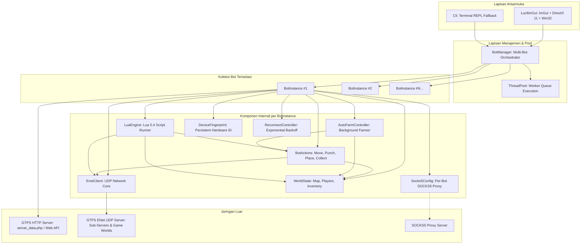
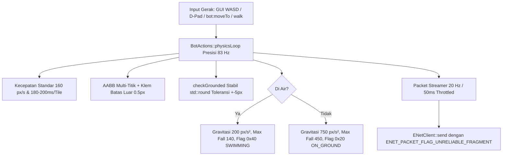

# 🏛️ Arsitektur Sistem — Lucifer GTPS Bot

Dokumen ini menjelaskan rancangan arsitektur perangkat lunak, pembagian modul, alur data (*data flow*), model multithreading, dan manajemen memori dalam **Lucifer GTPS Bot**.

---

## 1. Diagram Arsitektur Tingkat Tinggi



---

## 2. Alur Data (Data Flow)

Alur eksekusi aplikasi berjalan melalui tahapan terstruktur:

```text
[Aplikasi Start]
       │
       ▼
1. Baca Konfigurasi (.env atau config.json)
       │
       ▼
2. HTTP Login Phase
       ├── Mengirim HTTP POST / GET ke GTPS_LOGIN_URL
       ├── Parsing response: server_data.php pipe-delimited atau JSON
       └── Ekstraksi: server_ip, server_port, meta, token, loginurl
       │
       ▼
3. Inisialisasi Identitas Perangkat (Anti-Detection)
       ├── Load atau generate DeviceFingerprint (.fingerprints/<GrowID>.json)
       └── Format string handshake Growtopia (mac, rid, wk, fz, zf, hash, fhash, dll.)
       │
       ▼
4. Inisialisasi ENet Client
       ├── enet_host_create()
       ├── Aktifkan enet_host_compress_with_range_coder()
       └── Setup host->checksum = enet_crc32
       │
       ▼
5. Koneksi UDP & Handshake
       ├── Connect ke game_host:game_port
       ├── Terima NET_MESSAGE_SERVER_HELLO dari server
       └── Balas dengan NET_MESSAGE_GENERIC_TEXT (handshake identitas bot)
       │
       ▼
6. Proses Autentikasi & Masuk Game
       ├── Terima "Logon authenticated" / OnSuperMainStartAcceptLogon
       ├── Kirim action|enter_game
       ├── Terima PACKET_SEND_INVENTORY_STATE & PACKET_SEND_MAP_DATA
       └── Auto-warp ke TARGET_WORLD (jika disetel)
       │
       ▼
7. Main Loop (DirectX 11 GUI / CLI)
       ├── Polling ENet non-blocking (enet_host_service timeout 0)
       ├── Update ReconnectController jika terputus
       ├── Render ImGui tabs (Status, Multi-Bot, Movement, Inventory, Radar, Anti-Det, Lua)
       └── Dispatch Lua event hooks (OnDraw, OnVariant, OnProcessTankUpdate)
```

---

## 3. Pembagian Modul & Tanggung Jawab Kelas

### A. Lapisan Jaringan (`src/enet_client.*`, `src/http_client.*`, `src/socks5.*`)
- **`EnetClient`**:
  - Membungkus library `libenet` (C API) ke dalam antarmuka C++ modern.
  - Mengelola lifecycle `ENetHost` dan `ENetPeer`.
  - Mengirim paket dengan header 4-byte `[uint32 type] + [payload]`.
  - Polling non-blocking event (`ENET_EVENT_TYPE_CONNECT`, `DISCONNECT`, `RECEIVE`) dan dispatch callback ke luar mutex untuk mencegah *deadlock*.
- **`HttpClient`**:
  - Menggunakan `cpp-httplib` dan `WinHTTP` API bawaan Windows untuk menangani TLS/HTTPS dan self-signed SSL certificate bypass.
  - Menangani web login validation via Base64 token (`/player/growid/login/validate`).
- **`Socks5Client`**:
  - Implementasi murni protokol SOCKS5 (RFC 1928) & Username/Password Authentication (RFC 1929).
  - Melakukan TCP CONNECT handshake dan negosiasi UDP ASSOCIATE relay.

### B. Lapisan State Game (`src/world.*`, `src/game_packet.hpp`, `src/packet.hpp`)
- **`WorldState`**:
  - Menyimpan snapshot status world: ukuran map ($W \times H$), array tile (foreground, background, collision type, visual flag).
  - Melacak daftar pemain (`NetAvatar`) berdasarkan `net_id` dan `user_id`.
  - Melacak item yang jatuh di world (`WorldObject`) beserta koordinat pixel dan UID objek.
  - Melacak isi tas inventaris (`InventoryItem`) beserta item ID dan jumlah.
  - Thread-safe melalui `mutable std::mutex mtx_`.
- **`TankPacketHelper`**:
  - Serialisasi dan deserialisasi struktur biner 56-byte `GameUpdatePacket`.
  - **Aturan Validasi 61-Byte**: Memastikan paket state selalu memiliki trailing byte nol agar panjang paket total minimal 61 byte (`4 header + 56 struct + 1 trailing`), mencegah disconnect dari server GTPS modern.
  - Parser dan generator `VariantList` (data tipe string, float, integer, uint, vector).

### C. Lapisan Aksi & Otomasi (`src/bot_actions.*`, `src/lua_engine.*`, `src/bot_stats.*`)
- **`BotActions`**:
  - Menyediakan operasi tingkat tinggi: `moveTo(tx, ty)` (dengan interpolasi lintasan multi-step), `hit(tx, ty)`, `place(id, tx, ty)`, `wrench(tx, ty)`, `enter()`, `collectNearby(radius)`, `drop(id, count)`, `trash(id, count)`, `say(text)`, `warp(name)`, `respawn()`.
  - Tambahan: `wrenchPlayer(net_id)` — mengirim paket `action|wrench` ke player tertentu berdasarkan `net_id` untuk men-trigger dialog profil (`personal_info`).
- **`BotStats`** (`src/bot_stats.hpp/cpp`):
  - Struct data terpusat untuk menyimpan statistik akun yang terbaca dari server:
    - `level` (int), `gems` (int64), `playtime_hours` (int), `age_days` (int), `active_time_hours` (int).
    - `ip` (string publik), `mac` (string), `rid` (string), `wk` (string), `country` (string).
  - **Parsing logic**: `parseFromText(text)` menggunakan `std::regex` untuk mengekstrak field dari teks dialog `OnDialogRequest` (tipe `personal_info`) atau output console `/status`/`/stats`.
    - Regex `Level:\s*(\d+)`, `Gems:\s*([\d,]+)`, `Played\s*:\s*(\d+)\s*Hours`, `Age\s*:\s*(\d+)\s*Days`.
  - **Helper formatters**: `getFormattedGems()` → `"1,234,567"`, `getFormattedActiveTime()` → `"42h"`.
  - Thread-safe via `std::mutex mtx`.
  - Sumber data: `OnDialogRequest` (packet `dialog_return` tipe `personal_info`), dan `OnConsoleMessage` (output `/status` dan pesan spawn/world).
- **`AutoFarmController`**:
  - Menjalankan rutinitas penanaman/pembongkaran blok pada thread latar belakang terpisah.
  - Dilengkapi verifikasi ketersediaan stok inventaris dan auto-collect hasil drop.
- **`LuaEngine`**:
  - Mengintegrasikan Lua 5.4 ke dalam aplikasi C++.
  - Mendukung dua dialek sekaligus:
    1. **Bothax Lua Docs API**: `GetLocal()`, `GetWorld()`, `GetTiles()`, `GetPlayerList()`, `GetObjectList()`, `SendPacket()`, event hooks `OnVariant`, `OnSendPacket`, `OnProcessTankUpdate`, dll.
    2. **Lucifer Lua v2.86 API**: `bot:getLocal()`, `bot:getWorld()`, `bot:moveTo()`, `bot:hit()`, `bot:place()`, `bot:collect()`, `sleep()`, `log()`.

### D. Lapisan Anti-Deteksi & Reconnect (`src/anti_detection.*`, `src/reconnect_controller.*`)
- **`DeviceFingerprint`**:
  - Membuat identitas hardware realistis unik per akun.
  - Mengunci MAC, RID, WK, dan integer hash ke dalam file `.fingerprints/<GrowID>.json`.
- **`AntiDetection`**:
  - `sleepWithJitter(base_ms, jitter_ms)`: Memberikan deviasi acak $\pm15\text{--}25\%$ pada interval gerakan dan aksi bot.
  - `maybeHumanPause(chance, min_ms, max_ms)`: Simulasi jeda ragu manusia (micro-pause).
- **`ReconnectController`**:
  - Finite State Machine (`Connected`, `WaitingReconnect`, `Reconnecting`, `Disconnected`, `Disabled`).
  - Exponential backoff: $\text{delay} = \min(\text{max\_delay}, \text{initial} \times \text{multiplier}^n) \pm \text{jitter}$.
  - Otomatis reset counter ke 0 saat menerima `PACKET_SEND_MAP_DATA`.

### E. Lapisan Multi-Bot & Thread Pool (`src/bot_instance.*`, `src/bot_manager.*`, `src/thread_pool.*`)
- **`BotInstance`**:
  - Objek mandiri yang mengisolasi satu akun bot lengkap (ENet socket, World state, Actions, Lua, Fingerprint, Proxy).
- **`BotManager`**:
  - Mengelola kontainer `std::vector<std::shared_ptr<BotInstance>>`.
  - Fitur eksekusi massal: `startAll(stagger_ms)`, `stopAll()`, `warpAll()`, `sayAll()`, `loadAccountsFromFile()`, `saveAccountsToFile()`.
- **`ThreadPool`**:
  - Pool thread pekerja berkinerja tinggi dengan antrean tugas thread-safe (`std::condition_variable` & `std::queue`).

### F. Lapisan Antarmuka Grafis (`src/gui.*`)
- **`LuciferGui`**:
  - Inisialisasi Win32 Window dengan Dark Mode Immersive Theme (`DwmSetWindowAttribute`).
  - Inisialisasi Microsoft DirectX 11 Device, SwapChain, dan RenderTargetView.
  - Integrasi Dear ImGui dengan **Palet Deep Space Navy & Electric Cyan (Identik dengan Lucifer v2.85)**:
    - Background: Sangat gelap `#070d16`
    - Card Panels: Dark Navy `#0b1726` dengan Border `#143352`
    - Akses & Seleksi: Electric Cyan `#00a8ff` / `#0090e3`
    - Status Online: Neon Lime Green `#00ff88` / `#2ecc71`
  - **Widget Kustom Khas Lucifer**:
    - `ToggleSwitch(id, bool*)`: Sakelar toggle berbentuk pil lonjong modern dengan sliding circular knob putih.
    - D-Pad Cross Navigation: Layout salib simetris dengan tombol Enter Pintu/Portal (`🚪`) di pusat.
  - **Hierarki Navigasi Antarmuka Lucifer v2.85**:
    - **Title Bar**: Judul `Lucifer v2.85 [discord.gg/nuron]` dengan kontrol ikon `[+]`, `[🔒]`, `[🔄]`, `[⏻]`.
    - **Top Navigation Bar**:
      1. `[ 🤖 Bots ]`: Dashboard utama (Sidebar pemilih bot + Konten Sub-Tabs).
      2. `[ 📋 List ]`: Tampilan tabel multi-bot lengkap (ID, Akun, Status, World, Gems, Ping, Proxy, Aksi).
      3. `[ </> Executor ]`: Editor skrip Lua 5.4 multi-baris dan executor.
      4. `[ 🌐 Proxy ]`: Pengelola & live tester koneksi proxy SOCKS5 (RFC 1928/1929).
      5. `[ 🔀 Switch ]`: Peralihan cepat sub-server dan kontrol fast-reconnect.
      6. `[ 🗄️ Database ]`: Cache database item Growtopia (`items.dat`) dengan filter pencarian instan.
      7. `[ ⚙️ Settings ]`: Konfigurasi server host, port, login URL, versi game, dan protokol.
    - **Panel Kiri `[ 🤖 Bots ]` (Sidebar Bot Selector)**:
      - Toggle `Select All` + Checkbox `Enable Multi-Select`.
      - Box daftar bot dengan status online berwarna hijau neon (`#00ff88`).
      - Input pencarian: `Search for bots..`
      - Tombol aksi: `[ Load ]`, `[ Save ]`, `[ Add Bot ]`, `[ Remove Bot ]`.
    - **Panel Kanan `[ 🤖 Bots ]` (Sub-Tabs)**:
      - Sub-tabs: `[ Main ]`, `[ World ]`, `[ Inventory ]`, `[ Console ]`, `[ Automation ]`, `[ Rotation ]`, `[ Logs ]`, `[ RID ]`.
      - **Sub-Tab `[ Control ]` (PC Keyboard & Gamepad Controller)**:
        - **Left Deck**:
          - Status bot terpilih, koordinat pixel `(pos_x, pos_y)`, tile `(tx, ty)`, status lantai/lompat, arah hadap.
          - Virtual Arcade Keycap WASD + Spacebar yang menyala neon dinamis saat tombol fisik keyboard ditekan (`IsKeyDown`).
          - Tombol aksi: `[ E: Punch ]`, `[ F: Place ]`, `[ Q: Wrench ]`, `[ Enter: Door ]`, `[ C: Collect ]`, `[ R: Respawn ]`.
          - Quick Hotbar selector item dari tas inventaris untuk pasang blok instan (`Place`).
        - **Right Viewport**:
          - Radar mini-map 11x9 grid berpusat pada posisi bot saat ini.
          - Menampilkan blok solid (Bedrock, Dirt, Granite, Laser), platform kayu, background, item drop (permata), dan avatar bot `[🤖]`.
          - Interaksi mouse langsung pada grid: Klik Kiri untuk memukul (Hit), Klik Kanan untuk memasang (Place) item terpilih, dan Klik Tengah untuk Wrench.
      - **Sub-Tab `[ RID ]` (Hardware Identity & Network Inspector)**:
        - Memvisualisasikan dan mengelola identitas digital bot yang dipilih:
        - Menampilkan IP aktif yang digunakan (Proxy SOCKS5 IP:Port atau Direct IP lokal), status koneksi proxy, dan server target GTPS.
        - Menampilkan komponen hardware: MAC Address, RID (UUID), Country code, WK token, Hash, Hash2, fhash, fz/zf, dan Device Version.
        - Tombol `📋 Copy` pada setiap baris field, tombol `🎲 Acak Ulang Fingerprint` yang langsung memperbarui cache persisten `cache/fingerprints/<GrowID>.json`, tombol `💾 Simpan`, dan tombol `📋 Salin Semua Info Akun`.
      - **Grid 2x2 pada Sub-Tab `[ Main ]`**:
        1. **Card `👤 Bot Information` (Kiri Atas)**:
           - Status Online & Ping ms `[37?]`, Google Idle, Level & Gems, World & Posisi Tile `(X, Y)`, Played & Age.
           - Input nama world, tombol `Leave`, `Warp`, serta tombol utama `Connect` & `Disconnect`.
        2. **Card `✥ Movement` (Kanan Atas)**:
           - Tombol `Respawn` di header card.
           - Tombol navigasi D-Pad bersilang: `[↑]`, `[←]`, `[🚪]`, `[→]`, `[↓]`.
           - Slider jarak langkah tile (`1`-`10`) dengan ikon indikator dan gear setting.
        3. **Card `⚙️ Preferences` (Kiri Bawah)**:
           - 5 Baris opsi toggle Lucifer: `Bypass Logon`, `Auto Reconnect [9.4]`, `Auto Collect`, `Auto Accept`, `Auto Disconnect On Mod`.
        4. **Card `🕒 Intervals` (Kanan Bawah)**:
           - Toggle `Dynamic Delay` pada header card.
           - 4 Baris interval dengan random jitter: `Move`, `Collect`, `Hit`, `Place` (contoh: `0.235s (+0.111s)`).

---

## 4. Model Multithreading & Sinkronisasi

Aplikasi menggunakan model thread terdistribusi:

| Nama Thread | Tugas Utama | Mekanisme Sinkronisasi |
|---|---|---|
| **Main Render Thread** | Windows Message Loop (`PeekMessage`), ENet polling, Dear ImGui render, DirectX 11 Present (~60 FPS) | - |
| **ThreadPool Workers (Default: 4)** | Menangani staggered login, broadcast packet massal, asynchronous DNS resolution, SOCKS5 TCP connect | `std::unique_lock<std::mutex>`, `std::condition_variable` |
| **AutoFarm Worker Thread** | Loop placing, hitting, and collecting blok per-bot | `std::atomic<bool> running_`, sleep ber-jitter |
| **Movement Interpolator Threads** | Pergerakan multi-tile halus di background agar tidak memblokir render frame GUI | Thread detach dengan interval `step_delay_ms` |
| **CLI Input Thread (Fallback Mode)** | Membaca input terminal stdin saat berjalan tanpa DirectX 11 | `std::getline` pada worker thread terpisah |
| **Lua Worker & Hook Dispatcher** | Menjalankan skrip Lua terisolasi, background polling hook liveness, timer `RunDelayed`, dan variadic thread `RunThread` | `std::recursive_mutex lua_mtx_`, `std::atomic<int> hook_count_` |

### Prinsip Keamanan Thread (Thread Safety)
1. **Tidak Ada Deadlock Callback**: Callback `EnetClient::onPacket`, `onConnect`, dan `onDisconnect` selalu menyalin delegat ke variabel lokal sebelum memanggilnya di luar *lock mutex*.
2. **Atomic States**: State kritis seperti `g_running`, `in_world_`, `handshake_sent_`, `auto_warped_`, `redirecting_` menggunakan `std::atomic<bool>`.
3. **World Snapshot Isolation**: Fungsi pembacaan world seperti `world.getTiles()` atau `world.getPlayers()` mengembalikan salinan data dengan proteksi mutex yang singkat.
4. **Single-Instance Auto-Termination**: Saat aplikasi diluncurkan ulang, fungsi `terminatePreviousInstances()` di `src/main.cpp` secara otomatis mendeteksi dan menterminasi instance proses lama (`CreateToolhelp32Snapshot`, `WM_CLOSE`, `TerminateProcess`), mencegah konflik socket ENet, proxy reuse collision, dan double-windowing DirectX 11. Flag `--allow-multiple` tersedia jika pengguna membutuhkan multi-instance secara eksplisit.

---

## 5. Manajemen Memori & RAII

- Semua kepemilikan resource menggunakan pola **RAII (Resource Acquisition Is Initialization)**.
- `std::unique_ptr` digunakan untuk komponen kepemilikan tunggal dalam `BotInstance`.
- `std::shared_ptr` digunakan pada `BotManager` untuk membagikan referensi bot ke antarmuka GUI secara aman.
- Resource Win32 & DirectX 11 (Device, Context, SwapChain, RenderTargetView, HWND) dibersihkan secara berurutan dalam destructor `LuciferGui::shutdown()`.
- State Lua runtime dibersihkan melalui `lua_close(L)` dalam destructor `LuaEngine`.

---

## 6. Arsitektur Jaringan, Server-Data Caching & Failover Resilience

### Topologi Pemisahan Web Server & Game Server (GTPS)
Pada server Growtopia Private Server (GTPS), infrastruktur sering kali dipisahkan menjadi dua mesin/IP yang berbeda:
1. **Web Host (`server_data.php`)**: Melayani HTTP POST data konfigurasi awal (`server`, `port`, `meta`, `loginurl`).
2. **Game Host (UDP ENet Server)**: Server inti tempat bot bermain (`51.79.162.77:17013`).

### Mekanisme Failover Caching pada BotInstance
Ketika web host mengalami *downtime*, rate limiting, atau packet loss:
1. **Server Detail Caching**: Begitu `server_data.php` berhasil dibaca pada koneksi awal, `BotInstance` menyimpan `cached_server_ip_`, `cached_server_port_`, dan `cached_meta_`.
2. **Graceful Fallback**: Jika `server_data.php` sewaktu-waktu timeout (misalnya saat reconnect setelah server reboot), bot otomatis menggunakan data cache game server terakhir daripada jatuh ke host web yang mati.
3. **Konfigurasi Default .env**: Parameter `GTPS_GAME_SERVER` dan `GTPS_GAME_PORT` diarahkan langsung ke game host aktif (`51.79.162.77:17013`) sebagai jaring pengaman awal.

### Arsitektur Terowongan Proxy SOCKS5 (Dual-Stack TCP & UDP RFC 1928/1929)
Untuk menjamin privasi IP lokal dan menghindari rate limiting/IP ban saat mengoperasikan multi-bot:
1. **TCP HTTP Tunneling (`HttpClient`)**:
   - HTTP login request (`server_data.php`) dialirkan melalui socket TCP yang telah dinegosiasikan dengan SOCKS5 CONNECT (`CMD 0x01`) oleh `Socks5Client::createConnectedSocket`.
   - Untuk endpoint HTTPS, WinHTTP dikonfigurasikan dengan named proxy `socks=<host>:<port>`.
2. **UDP ENet Loopback Bridge (`Socks5UdpTunnel`)**:
   - `libenet` berkomunikasi murni melalui paket datagram UDP tanpa dukungan proxy native.
   - Solusi: `Socks5UdpTunnel` membuka socket UDP lokal pada `127.0.0.1:<port_ephemeral>` dan memegang satu TCP Control Socket ke proxy server dengan perintah SOCKS5 `UDP ASSOCIATE` (`CMD 0x03`).
   - Setiap paket keluar dari `ENetClient` lokal dibungkus dengan header RFC 1928 (10 bytes: `0x00 0x00 0x00 0x01 <Target_IP> <Target_Port>`) lalu diteruskan ke Relay Proxy.
   - Paket balasan dari proxy relay di-decapsulate di background worker thread dan diteruskan kembali ke ENet loopback client tanpa latensi overhead yang terukur ($<0.05\text{ ms}$).
   - Saat bot dialihkan ke sub-server baru melalui `OnSendToServer`, terowongan otomatis me-restart relay ke IP dan port sub-server tujuan.
3. **Multi-Bot Orchestration & Quick Paste**:
   - Setiap `BotInstance` memiliki `Socks5Config` dan instans `Socks5UdpTunnel` sendiri yang sepenuhnya independen.
   - `BotManager` memiliki `default_proxy` yang diwariskan ke semua bot baru.
   - GUI menyediakan tab **🌐 Proxy** dengan fitur distribusi batch otomatis (Round-Robin) untuk membagikan daftar puluhan proxy ke bot yang ada.

---

## 7. Sistem Direktori Terpadu `cache/` (Storage Architecture)

Saat aplikasi pertama kali dijalankan, sistem otomatis membuat dan mengelola struktur folder `cache/`:

```
cache/
├── accounts.txt          # Kredensial akun bot dari GUI (GrowID:Pass:World:Proxy)
├── items.dat             # Database biner item Growtopia (diunduh dari server / lokal)
├── fingerprints/         # Profil isolasi hardware identitas perangkat per-akun
│   ├── default.json
│   └── <GrowID>.json
└── stats/                # Statistik live akun (Level, Gems, Played Hours, Age)
    └── <GrowID>.json
```

### Komponen Cache:
1. **`cache/fingerprints/`**:
   - Menyimpan token `mac`, `rid`, `wk`, `hash`, `fhash`, `fz`, `zf` untuk setiap akun bot secara terisolasi.
   - Dilengkapi sistem migrasi otomatis dari folder legacy `.fingerprints/` bila ditemukan profil lama.
2. **`cache/accounts.txt`**:
   - Tempat penyimpanan kredensial akun yang dimasukkan melalui antarmuka GUI (modal *+ Add Bot* / panel *Multi-Bot* / sidebar).
   - **Format Baris**: `GrowID[:Password][:TargetWorld][:ProxyHost:ProxyPort[:ProxyUser:ProxyPass]]`.
   - **Parser Toleran**: Menerima format nama saja (`GrowID`), format nama & sandi (`GrowID:Pass`), serta format lengkap.
   - **Auto-Sync & Pencegahan Duplikasi**: Kredensial otomatis tersimpan setiap kali bot ditambahkan, dihapus, atau saat aplikasi ditutup (`LuciferGui::shutdown()` & `main()`).
   - **Proteksi Anti-Wipe (Empty-Pool Guard)**: Fungsi `saveAccountsToFile()` mengecek apakah pool bot di memori kosong. Jika kosong namun file `cache/accounts.txt` sudah ada isinya, sistem menolak menimpa file untuk mencegah data akun terhapus secara tidak sengaja.
   - **Auto-Recovery dari Fingerprints**: Jika `cache/accounts.txt` kosong atau belum ada, program memindai folder `cache/fingerprints/` dan memulihkan profil akun (`<GrowID>.json`) yang pernah login kembali ke daftar bot dan menyimpannya secara otomatis.
   - **In-GUI Credential Editor**: Sub-tab Multi-Bot dan card detail bot dilengkapi kolom edit Password & Target World serta tombol simpan langsung ke `cache/accounts.txt`.
3. **`cache/items.dat`**:
   - Dikelola oleh modul singleton [`ItemDatabase`](file:///c:/Users/RIZIQ/Documents/testtt/src/item_database.hpp).
   - **Auto-Download**: Ketika server mengirim paket tank tipe 16 (`PACKET_SEND_ITEM_DATABASE_DATA`), byte mentah langsung disimpan ke `cache/items.dat` dan didekripsi menggunakan sandi cipher Growtopia (`PBGHF892FASDLFDND`).
   - Terintegrasi dengan tab GUI `[ 🗄️ Database ]` untuk live searching ribuan item, waktu panen, rarity, dan hit points.
4. **`cache/stats/`**:
   - Dikelola oleh modul [`BotStats`](file:///c:/Users/RIZIQ/Documents/testtt/src/bot_stats.hpp) untuk menyimpan riwayat statistik bot: `level`, `gems`, `played_hours`, `age_days`, `total_played_seconds`, dan `first_seen_epoch`.
   - **Otomasi Akumulasi Sesi**: Saat bot terhubung dan online di world (`OnSpawn`), timer sesi diaktifkan. Setiap 15 detik serta saat disconnect/shutdown, akumulasi detik bermain disimpan kembali ke file JSON akun tersebut.
   - **Pencegahan Reset Umur Akun**: Menggunakan `first_seen_epoch` yang diambil dari stempel waktu pembuatan profil fingerprint akun untuk menghitung umur akun dalam hari secara dinamis.
   - **Sinkronisasi Instan**: Dilengkapi tombol `[ 🔄##query_stats ]` pada GUI yang mengirim instruksi `/status` dan `/me` ke GTPS server untuk mengupdate nilai terbaru.

---

## 8. Sistem Fisika, Deteksi Tabrakan & Gravitasi (Physics & Gravity Engine)

Dalam game Growtopia asli, simulasi fisika 2D (kecepatan jatuh, gravitasi, lompatan, dan tabrakan lantai/platform) dihitung di sisi klien (*client-side physics*). Jika sebuah bot tidak menjalankan simulasi gravitasi, bot akan tampak melayang (*hovering/floating*) di udara pada koordinat spawn pintu putih atau saat berpindah posisi secara horizontal, yang sangat mudah dideteksi oleh moderator (*fly-hack giveaway*).

Sistem fisika **Lucifer GTPS Bot** mengimplementasikan mesin gravitasi presisi berbasis grid tile (32x32 pixel):

### 1. Model Dimensi & Bounding Box Karakter
- **Dimensi Tile**: 32 x 32 pixel.
- **Bounding Box Karakter**: Lebar 20 px (`pos_x + 6` s/d `pos_x + 26`), Tinggi 32 px.
- **Posisi Kaki (*Feet Y*)**: `pos_y + 32.0f`.
- **Level Berdiri di Atas Tile**: Ketika berdiri di atas baris tile `ty`, koordinat `pos_y = (ty - 1) * 32.0f` dan kaki berada tepat di `ty * 32.0f`.

### 2. Klasifikasi Tabrakan Tile (`WorldState`)
- **Solid Blocks (`isSolidTile`)**: 
  - Bedrock (ID 8), Dirt (ID 2), Granite (ID 4), Obsidian, Foreground blocks (`action_type == 14, 16, 28, 30` atau `collision_type == 1`).
  - Menahan karakter dari segala arah (lantai, dinding, dan atap). Karakter tidak dapat menembus blok solid.
- **Platforms (`isPlatformTile`)**:
  - Wooden Platform (ID 18, `action_type == 13` atau `collision_type == 2`).
  - *One-way jump-through*: Karakter dapat melompat menembus ke atas, namun tertahan jika mendarat/jatuh dari atas. Menekan tombol Down (`dropDown()`) memungkinkan karakter turun melewati platform.
- **Non-Solid / Passable**:
  - Udara (`fg == 0`), Background wallpaper (`action_type == 17`), Pintu (`action_type == 2, 12`), Kunci (`action_type == 3`), Bibit/Seeds (`action_type == 18`, ID ganjil).

### 3. Simulasi Gravitasi & Perhitungan Delta Time (`BotActions::updatePhysics`)
- **Konstanta Gravitasi Alami**: `GRAVITY = 750.0f` px/s², `MAX_FALL_SPEED = 450.0f` px/s.
- **Alur Per Frame Tick**:
  1. Mengecek apakah karakter berpijak di atas tanah/platform (`checkGrounded`).
  2. Jika karakter di udara: akselerasi kecepatan vertikal `velocity_y_ += GRAVITY * dt`.
  3. Cek sundulan kepala ke langit-langit solid saat melompat (`velocity_y_ < 0`).
  4. Deteksi benturan lantai solid via `findGroundY(cur_x, cur_y)`.
  5. Begitu menyentuh permukaan: `velocity_y_ = 0.0f`, posisi `cur_y` diselaraskan ke lantai (`snapToGround`), `flags` diberi bitmask `TankFlags::ON_GROUND (0x20)`, dan paket state konfirmasi dikirim ke server.
- **Throttled State Streaming (20 Hz / 50ms)**: Saat melayang/jatuh bebas atau di udara saat melompat, paket state dikirim ke server setiap 50ms (sesuai tick rate resmi client Growtopia: 20 Hz) untuk mencegah burst packet rate-limit kicks dari server GTPS.
- **Kontur Kontinu pada `moveTo`**: Saat bot berpindah tile, ketinggian `step_y` mengikuti kontur lantai tanah sehingga bot tidak melangkah ke udara kosong.

### 4. Perbedaan Paket Lompat Murni vs Terbang / Melayang & Mesin Lompat Aktif
- **Gotcha Protokol GTPS**: Flag `0x800` (`2048`) sering disalahartikan sebagai "Jumping", padahal dalam game Growtopia flag `0x800` adalah **`TankFlags::WINGS_FLYING`** (terbang menggunakan sayap/jetpack hovering). Jika bot mengirim `0x800`, server dan client pemain lain akan merender bot dalam animasi terbang/melayang.
- **Lompatan Asli Pemain (Real Player Jump)**:
  - Karakter pemain melompat **TIDAK PERNAH** mengirim bitmask `0x800`.
  - Paket state lompat murni hanya mengirim impuls kecepatan vertikal awal (`velocity_y_ = -340.0f` px/s), flag arah hadap (`0x00` untuk kanan, `0x10` untuk kiri), tanpa flag `ON_GROUND (0x20)`. Nilai `-340.0f` menghasilkan tinggi lompatan normal ~2.4 tile dan berada jauh di bawah ambang deteksi high-jump server (`speed_y < -400.0f`).
- **Active Trajectory Thread**:
  - Di Growtopia, server tidak menghitung busur parabola pemain secara otomatis jika klien hanya mengirim 1 paket `speed_y`. Klien pemain asli wajib mengirim serangkaian paket posisi `pos_y` yang naik dan turun seiring berjalannya waktu.
  - Implementasi `BotActions::physicsLoop()` menyimulasikan percepatan gravitasi `GRAVITY = 750.0f` px/s² per 12ms tick dan menyiarkan pembaruan koordinat `pos_y` ke server setiap 50ms.
  - Saat melompat melalui `jump()`, timestamp paket terakhir `last_state_packet_tp_` disinkronkan seketika agar loop utama tidak mengirim paket duplikat dalam selang < 30ms.
  - Saat menyentuh lantai, bot mengirim paket konfirmasi pendaratan dengan `speed_y = 0.0f` dan flag `TankFlags::ON_GROUND`.

### 5. Mesin Gerak Real-Time Kontinu Seperti Player Asli (`BotActions::physicsLoop`)
- **Kendali Berjalan Berkelanjutan (Holding Key to Run)**:
  - Pada game Growtopia asli di PC/Mobile, pemain **menahan tombol panah** (atau tombol `A` / `D`) untuk terus berlari melintasi dunia, dan karakter berhenti seketika saat tombol dilepas.
  - Kecepatan berjalan standar pemain Growtopia un-modded adalah **160.0f px/s** (setara 5 tile per detik atau 200ms per tile). Penggunaan kecepatan berlebih (seperti 240 px/s) memicu deteksi speedhack pada anticheat GTPS.
  - Implementasi menggunakan mesin **`physicsLoop()` kontinu presisi 83 Hz (12ms)**.
  - Tombol keyboard (`LeftArrow` / `A`, `RightArrow` / `D`) dan tombol D-Pad GUI (`←`, `→`) mendukung pembacaan status ditahan (*held-down state via `IsKeyDown` / `IsItemActive`*):
    - **Menahan tombol panah kiri / `A` / klik tahan `←`**: Karakter berjalan mulus ke kiri dengan kecepatan alami `160.0f` px/s.
    - **Menahan tombol panah kanan / `D` / klik tahan `→`**: Karakter berjalan mulus ke kanan dengan kecepatan alami `160.0f` px/s.
    - **Melepas tombol**: Karakter berhenti seketika, `velocity_x_` menjadi `0.0f`, dan bot mengirimkan 1 paket konfirmasi henti (`speed_x = 0, ON_GROUND`) lalu diam (*idle stand*).
- **Lompat Sambil Berjalan (Airborne Momentum)**:
  - Ketika pemain sedang menahan tombol jalan lalu menekan `UpArrow` / `W` / `Space`, karakter melompat ke udara dengan tetap membawa momentum horizontal `160.0f` px/s.
  - Karakter melayang dalam busur diagonal melompati rintangan/balok di udara dan mendarat kembali ke tanah seperti pemain manusia sungguhan.
- **Jatuh Alami dari Tebing/Jurang (Cliff Walking)**:
  - Jika bot berjalan melewati batas tebing/lantai yang berlubang, bot secara otomatis beralih ke status di udara (`on_ground_ = false`) dan ditarik gravitasi jatuh ke bawah sambil tetap mempertahankan momentum jalan ke depan.

### 6. Pencegahan Disconnect Akibat Menabrak Blok (Anti-Noclip & Anti-Kick Collision Protection)
Ketika pemain menabrak atau menekan tombol ke arah blok solid, server GTPS dapat memutuskan koneksi (*disconnect/kick*) jika mendeteksi pelanggaran noclip atau packet flooding. Modul fisika menerapkan 4 lapisan proteksi:
1. **Presisi Bounding Box AABB Karakter (`HITBOX_LEFT = 6.0f`, `HITBOX_RIGHT = 25.5f`)**:
   - Hitbox pemain Growtopia memiliki lebar 19.5 px dan tinggi 28.5 px.
   - Pengecekan horizontal sebelumnya yang menggunakan toleransi kasar (+22 px) menyebabkan karakter menembus 3–4 pixel ke dalam hitbox blok solid sebelum terdeteksi. Server GTPS mendeteksi *noclip penetration* dan seketika menjatuhkan kick/disconnect.
   - Sistem kini menguji seluruh rentang AABB sehingga karakter berhenti tepat sebelum menyentuh batas luar blok solid.
2. **Klem Batas Blok Luar dengan Safe Buffer (0.5px Margin Clamping)**:
   - Saat bergerak ke kanan dan menabrak blok di `target_tx`, koordinat diklem secara matematis ke `target_tx * 32.0f - 26.0f`. Batas kanan karakter `pos_x + 25.5f` bernilai `target_tx * 32.0f - 0.5f`, sehingga floor division `(pos_x + 25.5f) / 32` menghasilkan `target_tx - 1`. Karakter secara absolut berada di luar blok solid.
   - Saat bergerak ke kiri dan menabrak blok di `target_tx`, koordinat diklem ke `(target_tx + 1) * 32.0f - 5.5f`. Batas kiri `pos_x + 6.0f` bernilai `(target_tx + 1) * 32.0f + 0.5f` (di dalam `target_tx + 1`).
3. **Pemeriksaan Vertikal Multi-Titik (Head, Mid-Torso, Feet)**:
   - Dinding atau rintangan di depan diuji pada tiga ketinggian: kepala (`cur_y + 2.0f`), torso (`cur_y + 16.0f`), dan kaki (`cur_y + 30.5f`).
   - Mencegah bot menembus blok gantung di atas kepala (*hanging blocks / ceiling tiles*) saat melompat atau berjalan.
   - Menghapus fitur auto-step instan yang menaikkan posisi Y 32px tanpa lompat, yang sebelumnya memicu deteksi *speedhack/flyhack* pada server anti-cheat.
4. **Sampling Pijakan Kaki Terisolasi (`checkGrounded` & `findGroundY`)**:
   - Titik sampling pijakan lantai menggunakan `px + 7.0f` dan `px + 24.5f` (berada di dalam kolom tubuh karakter).
   - Menghindari kasus di mana bot yang merapat ke dinding samping mendeteksi tile dinding sebagai pijakan lantai dan mengira bot melayang/berdiri di udara.
5. **Peredaman Paket Jaringan saat Menempel Dinding (*Zero Oscillation & Spam*)**:
   - Ketika bot terhalang dinding (`blocked == true`), `velocity_x_` disetel ke `0.0f`.
   - Bot mengirimkan tepat 1 paket idle (`speed_x = 0, speed_y = 0`) saat menyentuh dinding, lalu berhenti menyiarkan paket selama posisi tidak berubah meskipun pemain tetap menahan tombol panah.
   - Meniadakan lonjakan paket berkecepatan tinggi (*rapid speed toggle oscillation*) yang memicu rate-limit ban server.
6. **Klem Sundulan Atap / Langit-langit (*Ceiling Anti-Noclip Clamp*)**:
   - Ketika bot melompat dan kepala membentur atap solid pada baris `head_ty`, koordinat `next_y` diklem ke `(head_ty + 1) * 32.0f + 0.5f`.
   - Hal ini menjamin posisi `pos_y` secara ketat berada di baris tile udara di bawah atap (`head_ty + 1`), bukan di dalam tile solid `head_ty` (yang sebelumnya terjadi jika dikurangi `HITBOX_TOP` sehingga `pos_y` terdorong 1.5px ke dalam blok solid dan memicu kick noclip seketika dari server GTPS).

### 7. Eliminasi "Mode Fly" & Penegakan Gravitasi Total (*Anti-Fly & Anti-Air-Jump Enforcement*)
Agar bot tidak berada dalam kondisi *mode fly* (melayang di udara, melompat tanpa batas di langit, atau berjalan di awan tanpa gravitasi), sistem menerapkan 4 proteksi ketat:
1. **Larangan Mutlak Lompat di Udara (*Strict Single Jump / Anti-Air-Jump*)**:
   - Pada `BotActions::jump()`, fungsi langsung mengecek `if (!on_ground_) return;`.
   - Karakter hanya diizinkan melompat jika kakinya menapak di atas tanah padat atau platform. Menekan tombol `W`, `UpArrow`, atau `Space` saat bot sedang di udara tidak akan menghasilkan lompatan tambahan (menghilangkan *air-jump / multi-jump fly hack*).
2. **Penegakan Gravitasi Tanpa Syarat (*Unconditional Gravity Tick*)**:
   - Evaluasi gravitasi dan pendeteksian tebing/lantai tidak lagi bergantung pada ketersediaan data tile map (`!tiles_.empty()`). Jika bot berada di udara, gravitasi selalu aktif menarik bot jatuh dengan percepatan alami `750.0f` px/s² menuju lantai dasar dunia (`Y = 1696.0f`).
   - `checkGrounded` tidak pernah mengembalikan `true` secara sembarangan saat bot berada di ketinggian langit.
3. **Pindai Signature Adaptif Peta World (`parseMapData`)**:
   - Parser peta memindai header secara adaptif dengan mencari signature matematis `width * height == tile_count` (contoh: 100 x 60 = 6000 tiles) pada 80 byte pertama payload `PACKET_SEND_MAP_DATA`.
   - Menghilangkan kegagalan pembacaan map akibat perbedaan versi/offset header server GTPS yang sebelumnya menyebabkan data tile kosong dan membuat bot melayang.
4. **Isolasi Event `OnSpawn` Karakter Lokal**:
   - Fungsi `parseSpawn` mengembalikan status `bool is_local`. Prosedur `onSpawned()` dan pengiriman paket inisialisasi state hanya dijalankan saat avatar bot lokal sendiri yang dimuat, mencegah interferensi reset posisi dan spam paket yang dipicu oleh kemunculan pemain lain di dalam world.

### 8. Pencegahan Disconnect pada Tab Control (*Anti-Noclip Platform Drop, Input De-duplication, & Reach Radius Validation*)
Untuk memastikan kontrol bot menggunakan PC WASD dan mouse pada tab **Control** berjalan mulus tanpa memicu kick/disconnect server:
1. **Penolakan Mutlak `dropDown()` pada Blok Padat (*Anti-Noclip Platform Guard*)**:
   - **Akar Masalah**: Pemain PC yang terbiasa dengan WASD secara natural menekan `S` (Down). Sebelumnya, `dropDown()` memindahkan posisi Y secara instan `cur_y + 34.0f` dan langsung mengirim paket state. Jika bot sedang berdiri di atas tanah/bedrock, bot diteleportasikan tepat ke dalam blok padat, menyebabkan anti-cheat GTPS mendeteksi pelanggaran noclip dan memutuskan koneksi secara instan.
   - **Solusi**: Di Growtopia, pemain asli hanya bisa turun jika berdiri di atas **Platform** (`isPlatformTile`). Jika bot berdiri di atas blok solid (`isSolidTile`), aksi `dropDown()` ditolak sepenuhnya. Jika bot berdiri di atas platform dan bagian bawahnya aman, sistem menyetel `ignore_platform_y_ = foot_ty` dan membiarkan gravitasi menarik karakter turun secara alami tanpa lonjakan koordinat instan.
2. **Isolasi Navigasi Keyboard ImGui pada On-Screen KeyCap (*De-duplication Protection*)**:
   - **Akar Masalah**: ImGui secara default memicu tombol yang memiliki fokus saat tombol `Space` atau `Enter` ditekan di keyboard. Hal ini menyebabkan penekanan Space memicu event `key_w_down` (lompat) dan sekaligus mengaktifkan tombol GUI yang sedang aktif, mengirimkan dua paket state lompat dalam selisih 0 milidetik (memicu deteksi rate-limit / air-jump).
   - **Solusi**: Helper `DrawKeyCap` kini diproteksi dengan `clicked && ImGui::IsItemClicked(ImGuiMouseButton_Left)` sehingga tombol visual arcade hanya terpicu oleh klik fisik mouse, bukan navigasi tombol keyboard.
3. **Validasi Batas Jangkauan Grid Radar (*Reach Radius Limit / Anti-Long-Punch*)**:
   - **Akar Masalah**: Viewport radar menampilkan grid 11x9 tile. Klik mouse pada tile di tepi grid (jarak 3–5 tile) sebelumnya langsung mengirimkan paket pukulan/pemasangan (`createTileChange`). Server GTPS mendeteksi interaksi jarak jauh sebagai *Reach Hack / Long Punch* dan mendiskoneksi bot.
   - **Solusi**: Klik pada grid dibatasi pada radius jangkauan realistis pemain (`dist_x <= 2 && dist_y <= 2`). Tile yang berada di luar jangkauan ditolak untuk pengiriman paket dan diberi tanda peringatan visual pada tooltip.
4. **Penyempurnaan Deteksi Dinding Kaki (*Safe Feet Horizontal Sampling*)**:
   - Koordinat vertikal pengujian rintangan kaki pada `physicsLoop` disetel pada `cur_y + 26.0f` (di dalam kolom badan dan di atas garis pijakan lantai) untuk mencegah sampel kaki menyentuh lapisan tanah datar sebagai balok penghalang.
5. **Pengamanan State Broadcasting Pra-World**:
   - Thread simulasi fisika memastikan bot telah terhubung penuh ke world dan memiliki `net_id` lokal yang valid sebelum mengevaluasi dan menyiarkan paket posisi.

---

## 9. Audit Mendalam & Perbaikan Arsitektur Movement (Deep Movement Engine Overhaul)

Audit mendalam terhadap pergerakan bot mengidentifikasi 8 akar penyebab desinkronisasi, kick anticheat, dan degradasi performa:



### 1. Penyatuan Navigasi `moveTo` ke dalam `physicsLoop` (Anti-Desync & Anti-Speedhack)
- **Kelemahan Sebelumnya**: `moveTo` membuat thread terpisah (`std::thread(...).detach()`) yang mengirim pembaruan posisi dengan delay `step_delay_ms = 35` (kecepatan ~914 px/s, 5.7x batas normal) dan menulis `setLocalPos()` tanpa penguncian `physics_mtx_`. Akibatnya, thread `moveTo` dan `physicsLoop` saling bertabrakan dan mengirim paket posisi yang melompat maju-mundur (jitter/teleport rubberbanding), memicu kick *Speedhack / Desync* dari server GTPS. Selain itu, `moveTo` lama tidak memiliki pengecekan tabrakan di sepanjang jalur dan menembus blok padat secara noclip.
- **Arsitektur Baru**:
  - `moveTo(tile_x, tile_y, step_delay_ms = 180)` kini sepenuhnya mendelegasikan navigasi ke variabel target `target_dest_tx_` di dalam `physicsLoop`.
  - Bot bergerak dengan kecepatan otentik **160.0f px/s** (200ms per tile), sepenuhnya mematuhi sistem AABB collision dinding, atap, dan gravitasi.
  - Dilengkapi fitur **auto-hurdle hop**: jika terbentur undakan 1 blok selama > 180ms, bot otomatis melompat untuk melewatinya. Jika dinding lebih tinggi dari 1 blok (rintangan tidak dapat dilewati), bot otomatis membatalkan navigasi dan berhenti dengan aman di depan dinding tanpa noclip.
  - Meniadakan seluruh race condition multi-threading antar modul.

### 2. Protokol Streaming Paket State Tanpa Reliabilitas (`ENET_PACKET_FLAG_UNRELIABLE_FRAGMENT`)
- **Kelemahan Sebelumnya**: Fungsi `EnetClient::send` menyetel semua paket dengan flag `ENET_PACKET_FLAG_RELIABLE`. Pada paket posisi berkecepatan 20 Hz (50ms interval), setiap paket menuntut balasan ACK dari server. Apabila terjadi latensi mikro atau server lambat memproses ACK, antrean reliable ENet tersumbat. Retransmisi paket koordinat lama yang tiba terlambat memicu deteksi teleportasi anticheat GTPS.
- **Arsitektur Baru**:
  - `EnetClient::send` kini menerima parameter `uint32_t enet_flags`.
  - Paket pergerakan kontinu (`PACKET_STATE`, tipe 0) disiarkan menggunakan **`ENET_PACKET_FLAG_UNRELIABLE_FRAGMENT`** sesuai standar game multiplayer berkecepatan tinggi. Jika ada 1 paket terlewat di jaringan, paket berikutnya 50ms kemudian langsung memperbarui posisi tanpa penumpukan antrean.
  - Paket kritis berbasis aksi (`PACKET_TILE_CHANGE_REQUEST`, `PACKET_TILE_ACTIVATE_REQUEST`, `PACKET_ITEM_CHANGE_OBJECT`, chat, warp) tetap dikirim dengan `ENET_PACKET_FLAG_RELIABLE`.
  - Logging paket posisi frekuensi tinggi dialihkan ke `Logger::logDebug` guna mencegah hitching I/O console Windows yang mengganggu kelancaran polling ENet.

### 3. Pemberantasan Beban Memori Ekstrem via `WorldState::hasTiles()`
- **Kelemahan Sebelumnya**: Pada setiap tick 12ms (~83 Hz), `physicsLoop` memanggil `!world_.getAllTiles().empty()` sebanyak 2 kali (pada pengecekan dinding dan pengecekan atap). Karena `getAllTiles()` mengembalikan salinan nilai (`std::vector<Tile>`), sistem mengalokasikan dan menyalin 6.000 hingga 20.000 elemen `Tile` sebanyak 166 kali per detik. Ini menyebabkan lonjakan CPU drastis dan mengunci `WorldState::mtx_`, membuat thread ENet kelaparan (*mutex starvation*) hingga ping timeout.
- **Arsitektur Baru**: Ditambahkan metode ringan `WorldState::hasTiles() const` yang hanya mengembalikan `!tiles_.empty()` di bawah mutex tanpa menyalin vektor.

### 4. Stabilisasi Pijakan Kaki `checkGrounded` dengan `std::round`
- **Kelemahan Sebelumnya**: Formula `int foot_ty = static_cast<int>(std::floor((feet_y + 1.0f) / 32.0f))` memiliki cacat matematis ketika bot berjalan datar di atas tanah. Presisi floating-point yang berfluktuasi tipis (misal `feet_y = 1726.5f`) menyebabkan `foot_ty` ter-floor ke baris udara di atasnya, sehingga `checkGrounded` bernilai `false` selama 1 frame. Bot sempat beralih ke state jatuh (`velocity_y_ = 50.0f`) lalu mendarat lagi pada tick berikutnya. Flapping status air-ground yang sangat cepat ini dibaca oleh anticheat server sebagai exploit *fly-mode / speedhack*.
- **Arsitektur Baru**: Menggunakan `int foot_ty = static_cast<int>(std::round(feet_y / 32.0f))` dipadu toleransi absolut `std::abs(feet_y - tile_top) <= 5.0f`. Karakter tetap grounded secara kokoh dan stabil saat berjalan datar tanpa flicker status.

### 5. Fisika Air & Flag `TankFlags::SWIMMING` (0x40)
- **Fisika Apung Air**: Ditambahkan metode `WorldState::isWaterTile(x, y)` (mendeteksi Water ID 822).
- Saat avatar bot berada di dalam air:
  - Percepatan gravitasi diturunkan menjadi `GRAVITY = 200.0f` px/s².
  - Kecepatan terminal jatuh dibatasi ke `MAX_FALL_SPEED = 140.0f` px/s.
  - Kecepatan berenang horizontal `120.0f` px/s.
  - Paket state menambahkan bitmask **`TankFlags::SWIMMING` (0x40)**. Ketiadaan flag ini di air sering memicu deteksi modifikasi client pada server GTPS.

### 6. Sinkronisasi Tile Dinamis Real-Time (`PACKET_TILE_CHANGE_REQUEST` & `PACKET_SEND_TILE_UPDATE_DATA`)
- Klien kini memproses paket tank tipe 3 dan 5 yang masuk dari server dan memperbarui grid `WorldState::setTile(x, y, fg, bg)`.
- Ketika bot atau pemain lain memecah atau memasang blok, rintangan fisik di peta langsung terbarui seketika. Mencegah bot menolak berjalan karena mengira blok yang sudah pecah masih solid.
- Pemanggilan `actions.onSpawned()` seketika saat `PACKET_SEND_MAP_DATA` selesai dimuat memastikan bot langsung selaras dengan tanah world yang baru dimasuki.

### 7. Pencegahan Bot Berlari Abadi saat Tab Beralih
- Saat pengguna berpindah sub-tab (misal dari Control ke Inventory) atau berpindah top-tab, sistem otomatis memanggil `stopMovement()` dan `cancelNavigation()` agar bot tidak terus berlari menabrak dinding di latar belakang.

### 8. Ekspansi API Lua untuk Gerak Fisik
- Skrip Lua kini dapat mengontrol pergerakan fisik secara presisi:
  - `bot:walk(direction, tiles)`: Berjalan teratur dengan timer berbasis token terisolasi (`walk_token_`).
  - `bot:walkLeft(tiles)` & `bot:walkRight(tiles)`
  - `bot:jump(power)`: Melompat alami dengan busur parabola.
  - `bot:dropDown()`: Turun melewati platform kayu.
  - `bot:moveTo(x, y, [delay])` & `bothaxFindPath`: Otomatis menunggu kedatangan bot (`waitForArrival`) sehingga aksi lanjutan dalam skrip Lua (seperti memukul/memasang) tidak dijalankan secara prematur di luar jangkauan (*anti-reach-hack*).

### 9. Arsitektur Sub-Tab Console Lucifer v2.85 & Engine Render Teks GT
Sub-tab **Console** pada Lucifer v2.85 dirancang khusus untuk memonitor log real-time in-game bot dan pesan server secara terisolasi per bot instance:
- **Struktur Pesan & Tag Kategorisasi (`ConsoleEntry` & `ConsoleMsgType`)**:
  - `[S]` (System): Status koneksi lokal, lookup IP server, pesan enter world, dan pengumuman sistem GTPS.
  - `[T]` (Task): Pesan tujuan, tutorial, quest, dan achievement server (misal: `[Welcome to Growtopia <1> #0] Lock the World (0/1)`).
  - `[W]` (World): Obrolan publik in-game dan balon bicara (`OnTalkBubble`).
  - `[P]` (Private): Bisikan / whisper pribadi dan transmisi khusus (`CP:`, dsb.).
- **Growtopia Color Code Rendering (`renderColoredGtText`)**:
  - Parser internal mengenali kode warna backtick Growtopia: `` `0 `` sampai `` `9 ``, `` `w `` (putih), `` `p `` (pink), `` `o `` (oranye), `` `b `` (hitam), `` `q `` (cyan), `` `e `` (biru muda), `` `r `` (hijau muda), `` `t `` (toska), `` `a ``/`` `s `` (abu-abu/perak), dan kode reset warna.
  - Segmentasi dilakukan tanpa alokasi memori berlebih (`flush_buf`) dan dirender inline menggunakan `ImGui::TextUnformatted` + `ImGui::SameLine(0, 0)` sehingga warna teks dalam satu baris berganti secara dinamis persis seperti client game asli.
- **Top Bar Controls & Viewport Filter**:
  - Tiga toggle switch: `Enable`, `Show Timestamps` (`[HH:MM:SS]`), dan `Auto Scroll`.
  - 4 Tombol Filter Pill: `[ 📋 All ]`, `[ 🌐 World ]`, `[ 💬 Private ]`, `[ ⚙ System ]` dengan highlight neon cyan aktif.
- **Interaksi Chat & Bottom Bar**:
  - Input teks interaktif `"Type a message to chat."` yang langsung mengeksekusi `bot->say()` saat menekan tombol `Enter`.
  - Tombol `[ Clear ]` untuk membersihkan riwayat pesan konsol instance bot yang dipilih.

### 10. Arsitektur Tab List Lucifer v2.85 (Multi-Bot Grid & Real-time Metrics)
Tab **List** (`[ 📋 List ]`) pada Lucifer v2.85 menyajikan tabel ringkasan terpusat untuk memantau armada bot:
- **Struktur Kolom Tabel (9 Kolom)**:
  1. `ID`: ID numerik unik instance bot (misal: `1`, `2`, `3`, `4`).
  2. `Name`: Nama akun GrowID bot (e.g. `xogavohat`, `rizzxyt`).
  3. `Level`: Level karakter bot saat ini.
  4. `Ping`: Latensi jaringan ENet real-time ke server game (ms).
  5. `Status`: Status koneksi dengan indikator warna (Hijau terang untuk `Online`, abu-abu untuk `Offline`).
  6. `Proxy`: Alamat endpoint proxy SOCKS5 (`host:port`) atau `Direct`.
  7. `World`: Nama world yang sedang dihuni bot dalam format kapital (`QUERELE`, `EXIT`, dsb.).
  8. `Position`: Koordinat ubin lokal bot dalam format `X:Y` (misal: `46:23`).
  9. `Gems`: Jumlah permata/gems yang terkumpul saat ini.
- **Interaksi Pemilihan Cepat**:
  - Mengklik baris bot mana pun pada tabel akan langsung mengubah `selected_bot_id_`, memberikan highlight visual baris aktif, dan menyelaraskan data di tab `Bots`, `Console`, dan `RID`.
- **Panel Metrik Ringkasan Bawah (Footer 4 Kolom)**:
  - `Online Count`: Jumlah total bot yang sedang aktif terhubung atau berada di world.
  - `Offline Count`: Jumlah bot yang sedang disconnected/idle.
  - `Total Bot Count`: Total seluruh armada bot yang terdaftar di pool.
  - `Total Gem Count`: Akumulasi gems seluruh bot terdaftar dalam format `Total / Target` (misal: `0 / 0`).
- **Sesuai Permintaan Pengguna**: Tombol batch status dan pembersih proxy non-aktif (`Remove Status`, `Remove Google Status`, `Remove Location Banned Proxies`, `Remove Offline Proxies`) telah dihilangkan sepenuhnya agar antarmuka bersih dan memaksimalkan ruang vertikal tabel.

### 11. Arsitektur Tab Executor Lucifer v2.85 (Script Editor & OnDialogRequest Inspector)
Tab **Executor** (`[ </> Executor ]`) mereplikasi 100% tata letak visual, fungsi kontrol, dan eksekusi skrip dari Lucifer v2.85:
- **Top Header Bar**:
  - Tombol indikator panah bawah `▼` dan tombol label `Selected Bot: <name | none>` yang membuka dropdown modal untuk memilih instance bot target.
  - Tombol aksi kanan:
    1. `[ Dialog ]`: Membuka modal pop-up `OnDialogRequest Inspector` untuk memeriksa string dialog mentah yang diterima bot terpilih dari server game GTPS lengkap dengan fitur penyalinan ke clipboard (`Copy Raw Dialog`).
    2. `[ Switch ]`: Beralih siklis (*cycle switch*) ke instance bot berikutnya dalam antrean.
    3. `[ Next ]`: Memilih instance bot selanjutnya secara berurutan dan memperbarui status aktif.
- **Viewport Editor & Line Number Gutter (ImGuiColorTextEdit)**:
  - Mengintegrasikan mesin editor kode profesional berkinerja tinggi berbasis `TextEditor` dengan palet warna khusus tema gelap Lucifer (`#030810`).
  - **Syntax Highlighting Penuh**: Pewarnaan sintaksis Lua secara real-time untuk *Keywords* (`local`, `for`, `in`, `do`, `end`, `if`, `then`, dll. - oranye/amber), *Strings* (hijau), *Numbers* (cyan terang), *Identifiers* (putih lembut), dan pengenal bawaan API bot Lucifer (`addBot`, `getBot`, `bot`, `world`, `log`, `sleep`, dll. - biru neon).
  - **Nomor Baris Kode**: Gutter nomor baris vertikal bawaan di sebelah kiri (`1`, `2`, `3`, ...) dengan pelacakan baris aktif (*active line highlight*) dan batas pemisah yang rapi.
  - **Default Kosong**: Sesuai preferensi pengguna, saat aplikasi pertama kali dibuka atau tombol `New` / `Delete` ditekan, buffer editor secara default dalam keadaan kosong (`empty/blank`).
- **Bottom Control Toolbar (7 Tombol Interaktif)**:
  1. `[ ▶ Run ]`: Mengambil kode langsung dari `text_editor_->GetText()` dan mengeksekusinya di background worker thread `LuaEngine`.
  2. `[ ■ Stop ]`: Menghentikan eksekusi skrip yang sedang aktif.
  3. `[ 📁 Save ]`: Menyimpan skrip editor ke berkas persisten `cache/scripts/executor.lua`.
  4. `[ 📁 New ]`: Mengatur ulang buffer editor ke keadaan kosong (`blank/new`).
  5. `[ 🗑 Delete ]`: Membersihkan seluruh buffer teks di editor skrip (`SetText("")`).
  6. `[ 🔍 View Error ]`: Membuka modal log galat eksekusi skrip Lua (`getLastError()`) dengan tombol salin log.
  7. `[ 🗔 WinConsole ]`: Beralih menampilkan atau menyembunyikan jendela native console Windows (`::ShowWindow(::GetConsoleWindow(), SW_SHOW / SW_HIDE)`).
- **Integrasi Lua Engine C API (`addBot`)**:
  - `LuaEngine` mengekspos fungsi global `addBot(info)` yang menerima tabel kamus konfigurasi bot (`display`, `secret`, `name`, `mac`, `rid`, `wk`, `world`, dll.) dan secara otomatis mendaftarkan serta mengonfigurasi instance bot baru ke dalam `BotManager`.

### 11. Arsitektur Threading & Deadlock Prevention pada LuaEngine & Hooks
- **Latar Belakang Masalah**:
  - Pada skrip otomasi berdurasi panjang atau *infinite loop* (misal: `while true do ... Sleep(2500) ... end` seperti skrip AFK), pemanggilan `luaL_dostring()` di worker thread sebelumnya mengunci `lua_mtx_` secara terus menerus selama skrip berjalan.
  - Saat paket jaringan GTPS (seperti `PACKET_CALL_FUNCTION` / VariantList, Tank Update, Ping) diterima oleh thread ENet, fungsi *dispatcher* hook (seperti `triggerOnVariant`) mencoba mengakuisisi `std::lock_guard<std::recursive_mutex> lock(lua_mtx_)`.
  - Hal ini memicu **deadlock total**: thread ENet terkunci membeku menunggu worker thread Lua, loop polling jaringan berhenti, server menganggap bot *timeout*, dan thread antarmuka grafis (GUI) menjadi *Not Responding* / macet (*hang*).
- **Solusi Rekayasa & Arsitektur Baru**:
  1. **Temporary Mutex Yielding saat `Sleep()`**:
     - Di dalam `LuaEngine::luaSleep()`, worker thread melepaskan kepemilikan lock (`worker_lock_->unlock()`) sebelum masuk ke `std::this_thread::sleep_for()`.
     - Selama durasi tidur (yang mencakup 99% dari waktu kerja skrip bot), thread jaringan ENet dapat secara instan mengakuisisi `lua_mtx_` untuk mengeksekusi hook callback.
     - Saat waktu tidur selesai, `luaSleep()` mengunci kembali mutex (`worker_lock_->lock()`) sebelum mengembalikan kendali ke bytecode Lua.
  2. **Non-Blocking Hook Dispatchers (`std::try_to_lock`)**:
     - Semua dispatcher event hook (`triggerOnVariant`, `triggerOnSendPacket`, `triggerOnSendPacketRaw`, `triggerOnProcessTankUpdate`, `triggerOnWorldTouch`) beralih dari blocking `std::lock_guard` ke `std::unique_lock<std::recursive_mutex> lock(lua_mtx_, std::try_to_lock)`.
     - Jika worker thread sedang aktif memproses instruksi Lua mikro (sepersekian mikrodetik), thread jaringan tidak akan pernah tertahan (*zero blocking*).
  3. **Granular Per-Event Atomic Hook Counters**:
     - Sistem menyediakan atomic counter spesifik: `hook_variant_count_`, `hook_send_packet_count_`, `hook_send_raw_count_`, `hook_tank_update_count_`, `hook_world_touch_count_`, `hook_draw_count_`, `hook_input_count_`.
     - Jika sebuah event tidak memiliki hook yang terdaftar (misal: skrip hanya memasang hook `OnSendPacket`), fungsi `triggerOnVariant` langsung mengembalikan `false` di baris pertama (*zero CPU cycle, zero mutex overhead*).
  4. **Normalisasi Nama Hook Case-Insensitive (`normalizeHookName`)**:
     - Penulisan nama hook dalam berbagai variasi huruf kapital (misal: `"onsendpacket"`, `"OnSendPacket"`, `"onvariant"`) otomatis dinormalisasi ke format kanonikal PascalCase yang dipahami oleh seluruh subsistem.


### 12. Optimasi Kinerja, Zero-Allocation Rendering, & Pencegahan Crash Multi-Thread
- **Pencegahan Crash Eksekusi Ganda Skrip (`runScript` 2x)**:
  - **Akar Masalah**: Meng-assign objek `worker_ = std::thread(...)` ketika worker thread sebelumnya masih `.joinable()` (meskipun `is_running_` sudah false) melanggar standar C++ dan memicu pemanggilan `std::terminate()` seketika.
  - **Solusi**: `LuaEngine::runScript()` selalu memanggil `stopScript()` di awal, memastikan worker thread lama di-join atau di-detach dengan aman sebelum thread baru dibuat.
- **Optimasi In-Game Console & Executor Logs (O(1) Pop & Dirty Flag)**:
  - **Migrasi Struktur Data**: `console_entries_`, `executor_logs_`, dan `fallback_console_entries_` dimigrasikan dari `std::vector` (dengan operasi `erase(begin())` bernilai O(N) saat batas 500 entri terlampaui) ke `std::deque` yang beroperasi dalam O(1) amortized `pop_front()`.
  - **Snapshot Cache & Dirty Flag**: `BotInstance` mengimplementasikan `console_dirty_` (atomic flag). Fungsi `getConsoleSnapshot()` hanya membangun ulang cache saat pesan baru masuk, mengeliminasi full-vector copy dari 500 pesan di setiap frame render (60 FPS).
- **Per-Frame Bot Caching (`cached_bots_`)**:
  - Di awal setiap frame (`renderMainLayout()`), fungsi `refreshBotCache()` mengambil daftar bot sekali saja ke dalam `cached_bots_`.
  - Semua sub-fungsi perenderan (`renderSidebar`, `renderTabList`, `renderTabExecutor`, `renderTabProxy`, `renderSubTabConsole`, `MultiBotTable`) membaca referensi `cached_bots_`, menghilangkan pembacaan berulang dan perebutan mutex `BotManager` puluhan kali per frame.
- **Zero-Heap Allocation pada Tabel ImGui**:
  - Mengganti alokasi `std::string` dinamis untuk label ID tombol (`"Start##" + to_string(id)`) dengan `ImGui::PushID(bot_id)` dan tombol statis (`"Start"`, `"Stop"`, `"Pilih"`, `"X"`, `"Uji"`, `"Direct"`).
  - Mengganti pembentukan string `row_id` dan timestamp dengan stack buffer `char buf[N]` dan `std::snprintf`, mengeliminasi puluhan ribu alokasi heap per detik pada multi-bot render loop.
- **Item Database Query Caching**:
  - Pemanggilan `db.findItems(search_item, 500)` di `renderTabDatabase()` dilindungi oleh buffer perbandingan `db_search_cache_buf_`. Pencarian hanya dieksekusi saat string pencarian pengguna berubah, bukan setiap frame 16ms.
- **Thread-Safety & Lifecycle Protection Deteksi IP Publik**:
  - `BotInstance::refreshPublicIpAsync()` dilindungi dengan struktur `IpFetchState` berbasis `std::shared_ptr`.
  - Jika `BotInstance` dihancurkan saat background HTTP request masih berlangsung, destruktor menandai `cancelled = true`, mencegah thread detached mengakses memori `this` yang sudah bebas (*use-after-free mitigation*).
  - Variabel `detected_ip_` dan `server_reported_ip_` disinkronkan menggunakan `ip_mtx_`.
